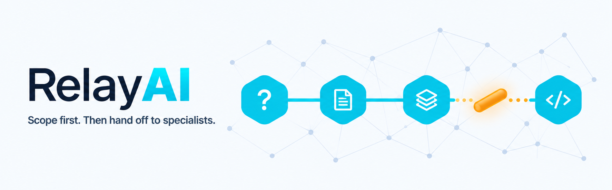

<p align="center">
  
</p>

# RelayAI

RelayAI sets up **GitHub Copilot (VS Code)** and **OpenCode**, project by project, to scope
your work and interrogate you about it before any code gets written, and then to hand the
implementation to specialist agents. One command, `relay-ai init`, installs the scoping skills
of [mattpocock/skills](https://github.com/mattpocock/skills), RelayAI's own agents and skills
for Python, LangGraph and FastAPI, and a local knowledge graph of your code
([Graphify](https://github.com/Graphify-Labs/graphify)) that the agents query before exploring
it.

RelayAI doesn't reinvent what already exists: it builds on top of other open-source
projects and open standards, and adds what's missing between them. See [Credits](#credits).

## How it works

1. You scope the work with mattpocock/skills: `/grill-me` interrogates you about what to
   build, `/to-spec` turns the conversation into a spec and `/to-tickets` breaks the spec
   into tickets.
2. The instructions file RelayAI writes for each platform lists its specialist agents, so
   `/to-tickets` adds a `**Specialist:** <agent>` line to every ticket whose core work falls
   under one of them.
3. `/implement` and `/implement-spec` delegate those tickets to the named specialist as a
   subagent. You can also pick a specialist yourself (see [What's in it](#whats-in-it)).
4. While they work, the agents check the Graphify graph before exploring your code and
   record what they confirmed, so the next task starts from it
   (see [Exploration memory](#exploration-memory)).

The routing in steps 2 and 3 is done by instructions to the model, not by a dedicated
command.

## What's in it

- **mattpocock/skills** — the engineering and productivity skills (`grill-me`, `tdd`,
  `to-spec`, `to-tickets`, `code-review`, `diagnosing-bugs`, …), unmodified. See its README
  for the full list.
- **`langgraph-expert`** (RelayAI) — a LangGraph specialist agent for async
  Python/FastAPI projects, covering the LangChain agents, tools and middleware graphs are
  built from. Pick it in the agent picker (Copilot) or call it with `@langgraph-expert`
  (OpenCode). It checks the live LangGraph docs before using an API, works test-first,
  builds async, stateless nodes and tools that are safe with many concurrent users, and
  calls out anti-patterns plainly — symptomatic fixes, dead or redundant code,
  over-engineering, LangGraph misuse — with a simpler way to build the feature.
- **`fastapi-expert`** (RelayAI) — a FastAPI specialist agent for the application layer
  around your graphs: the lifespan as the composition root, settings, dependencies, error
  handling, middleware, WebSockets and SSE, conversation management and tests. Pick it in
  the agent picker (Copilot) or call it with `@fastapi-expert` (OpenCode). It reads the
  official FastAPI skill shipped inside the FastAPI installed in your project (since
  0.134.0), so its API guidance always matches your version, and adds secure, typed
  WebSocket patterns (handshake checks before `accept`, structured concurrency for
  cancellation and disconnects). It works with the `langgraph-expert` through a clear
  contract: the graph and its factory are that agent's, everything around them is this
  one's. To make the official FastAPI skill available to every agent too, run
  `uvx library-skills` in your project (`--copy` on Windows without Developer Mode).
- **`debugging-python`** (RelayAI) — a Python debugging skill the agent loads on its own
  when debugging, alongside `diagnosing-bugs` and the official `mcp-debugger` skill. It
  makes the agent observe the real values at the point of failure with a real debugger
  ([mcp-debugger](https://github.com/debugmcp/mcp-debugger), driving a temporary `debugpy`)
  instead of guessing, while keeping token use low: shape before values, projections
  instead of dumping large objects, conditional breakpoints. The debugger runs locally and
  sends nothing out of your machine. Before each session the agent asks you whether to
  **launch** the code on your machine or **attach** to it where it runs (a container,
  for example). The first time a mode works, it records the recipe it worked out — from
  your compose files, Dockerfiles and uv setup — in `docs/agents/debugging.md`, with a
  separate compose override (`docs/agents/debugging.compose.yaml`, loopback ports only)
  so your compose files are never edited. Later sessions reuse the recipe and re-check
  only what changed. Both files are visible in git for you to review and commit; they
  hold variable names, never secret values.
- **`writing-python`** (RelayAI) — the default Python code style every agent writes and
  reviews with: code in English, ruff with 100 columns and single quotes, absolute imports,
  mandatory native type hints (PEP 695 generics on 3.12+), no comments explaining code,
  fail-fast exceptions caught only at the edge. It lists the ruff rules that check it and
  proposes them when your project has no ruff configuration. Your project's own ruff
  settings, Python version and documented standards always take precedence.
- **`auditing-code`** (RelayAI) — audits how your whole application uses each framework
  against its specialist's rules: LangGraph/LangChain with the `langgraph-expert`, FastAPI
  with the `fastapi-expert`. Run `/auditing-code` (optionally with `langgraph` or `fastapi`
  and a folder) or ask an agent to audit the application. Without a framework, it audits
  every one your project depends on. It only reads the code, starting from the Graphify
  graph (recording what it located in Graphify's work memory, see
  [Exploration memory](#exploration-memory)), and writes one English report per framework to
  `docs/audits/<framework>-<date>.md`: an inventory, then one finding per wrong pattern,
  with its occurrences, the target pattern, its cost and what it depends on, compared with
  the previous audit. Each finding is ready to plan with `/to-spec` and `/to-tickets`.
- **Project discovery** through Graphify's knowledge graph, kept up to date by its git
  hooks, with a work memory of what earlier tasks found
  (see [Exploration memory](#exploration-memory)).

The decisions behind all of this are logged in [`SCOPE.md`](SCOPE.md) (in Portuguese).

## Prerequisites

RelayAI needs uv, which runs the installer and installs Graphify, and Node.js 22 or newer for
its debugger. Without Node.js, `init` still installs everything, configures the debugger and
tells you how to install Node.js; the debugger only starts once Node.js is there.

git is optional: outside a git repository, `init` skips Graphify's git hooks and keeping
RelayAI's files out of git.

### uv

[uv](https://docs.astral.sh/uv/getting-started/installation/) runs the RelayAI installer and
installs Graphify.

- Windows (PowerShell): `powershell -ExecutionPolicy ByPass -c "irm https://astral.sh/uv/install.ps1 | iex"`
- macOS / Linux: `curl -LsSf https://astral.sh/uv/install.sh | sh`

### Node.js 22 or newer

Node.js runs the debugger the agents use ([mcp-debugger](https://github.com/debugmcp/mcp-debugger)).

1. Check whether you have it, and which version:

   ```bash
   node --version
   ```

   If it prints `v22` or higher, you're done.
2. Otherwise, install the current LTS:
   - **Windows:** `winget install OpenJS.NodeJS.LTS`, or the installer from
     [nodejs.org](https://nodejs.org/en/download).
   - **macOS:** `brew install node`, or the installer from
     [nodejs.org](https://nodejs.org/en/download).
   - **Linux:** your distribution's package manager, or
     [nvm](https://github.com/nvm-sh/nvm) (`nvm install --lts`).
3. Open a **new** terminal and run `node --version` again.

## Installation

From the root of your project:

```bash
uvx --from git+https://github.com/hugoadriao/relay-ai relay-ai init
```

To install into another folder, pass its path after `init` (`update` and `uninstall` take
it too).

`init` asks which platform to install for: **GitHub Copilot (VS Code)**, **OpenCode**, or
**both**. To skip the question, pass `--platform copilot`, `--platform opencode` or
`--platform both`; without an interactive terminal, the flag is required. In a project where
RelayAI is already installed, `init` without `--platform` keeps the platforms you chose
before.

Then:

1. **Reload your editor** so it picks up the new agents, skills and MCP servers:
   - VS Code: run **Developer: Reload Window** from the Command Palette. Agents, skills and
     MCP servers only show up after the reload.
   - OpenCode: restart it.
2. Build the knowledge graph. In the chat, run:

   ```
   /graphify .
   ```

   In OpenCode, `@graphify .` (see [Calling skills](#calling-skills)). Graphify reads your
   code and docs and writes the graph to `graphify-out/`. RelayAI doesn't build it for
   you; after this first build, Graphify's git hooks keep it up to date.
3. Once per repository, in the chat, run:

   ```
   /setup-matt-pocock-skills
   ```

   In OpenCode, `@setup-matt-pocock-skills`. It asks how your project tracks issues and
   where its docs live, and saves that to `AGENTS.md`, which both Copilot and OpenCode
   read. `init` creates an empty `AGENTS.md` for this when your project has neither
   `AGENTS.md` nor `CLAUDE.md`.
4. The first time an MCP server starts, your editor may ask you to trust it.

### Calling skills

This README writes skills the way Copilot calls them, with `/`: `/graphify .`, `/to-spec`.
OpenCode calls skills with `@` instead:

- **OpenCode 2.x:** type `@` and pick the skill from the list (`@graphify .`, `@to-spec`),
  or open the skill picker with `/skills`. The `/` list only shows commands, not skills.
- **OpenCode 1.x:** open the skill picker with `/skills`, or type the skill's whole name
  followed by a space (`/to-spec `). The `/` list doesn't show skills, and pressing Enter
  while it is open doesn't send the message. OpenCode 1.x also ignores the setting that
  reserves a skill for you to call (`disable-model-invocation`), so the model may load
  skills such as `to-spec` or `implement` on its own; 2.x respects it.

### What `relay-ai init` does

1. Installs the Graphify CLI if it's missing (`uv tool install graphifyy`) and puts it on
   your PATH (`uv tool update-shell`).
2. Copies the skills into `.agents/skills/`: RelayAI's own; the engineering and productivity
   skills of [mattpocock/skills](https://github.com/mattpocock/skills), from its `main`
   branch; and the official skill of [mcp-debugger](https://github.com/debugmcp/mcp-debugger),
   from the release tag that matches the debugger RelayAI configures. The third-party skills
   are copied unmodified, each with its original MIT `LICENSE`. If the mcp-debugger skill
   can't be downloaded, `init` says so and carries on. Skills follow the open
   [Agent Skills](https://agentskills.io) standard, and `.agents/skills/` is read by both
   VS Code and OpenCode (and other tools), so they're installed once.
3. For each platform you chose:
   - writes RelayAI's agents in that platform's format (`.github/agents/*.agent.md` for
     Copilot, `.opencode/agents/*.md` for OpenCode);
   - lists the specialist agents in a `relay-ai` section of the platform's instructions
     file (`.github/copilot-instructions.md` for Copilot, `AGENTS.md` for OpenCode), so
     ticket-writing and implementation skills route specialist work to them, points
     every agent to the `writing-python` style, and turns on Graphify's work memory (see
     [Exploration memory](#exploration-memory));
   - adds the MCP servers the agents use to the platform's config (`.vscode/mcp.json` or
     `opencode.json`), keeping the entries you already had.
4. Downloads the debugger (mcp-debugger) into npm's cache, after checking that the npm
   registry answers. It is configured with `npx --prefer-offline`, so once cached it
   starts without contacting the registry. If Node.js is missing or the registry can't be
   reached, `init` says how to fix it and carries on.
5. Sets Graphify up for the platforms you chose, exactly as it's designed to work:
   - adds RelayAI's agent and skill folders and `docs/audits/` to `.graphifyignore`, so
     the graph describes your code, not the installed agents and skills or old audit
     reports (existing lines are kept);
   - connects Graphify to each platform, which also installs its `/graphify` skill:
     `graphify vscode install` for Copilot and `graphify install --platform opencode`
     for OpenCode (Graphify puts the OpenCode skill in your user's OpenCode config,
     `~/.config/opencode/skills/graphify/`, and a plugin in `.opencode/plugins/`), so the
     agents check the knowledge graph before answering questions about your code;
   - `graphify hook install` — git hooks that update the graph on every commit and branch
     checkout once it exists (skipped if the project isn't a git repository).

   It does not build the graph: you do, with `/graphify .` (`@graphify .` in OpenCode,
   see above).
6. Keeps what it installed out of git: the agents and skills, the files it created
   (including `AGENTS.md`) and its manifest are listed in `.git/info/exclude`, which is
   local to your clone, so not even that list shows up in git. Graphify's own files
   (`graphify-out/`, `.gitattributes`, `.opencode/plugins/graphify.js`) stay visible,
   because Graphify is designed for the graph to be committed and shared. The exceptions
   are the two files Graphify derives from the work memory,
   `graphify-out/reflections/LESSONS.md` and `graphify-out/.graphify_learning.json`: they
   change on every commit and would conflict between branches, and agents rebuild them from
   the memories at the start of each session (see [Exploration memory](#exploration-memory)).
   If `init` had to change a file your repository already tracks, it tells you, so you can
   review that diff.
7. Records everything it installed or added in `.github/relay-ai.json` (the manifest), so
   `update` and `uninstall` touch only what is RelayAI's.

`init` never overwrites your own agents and skills: if one of yours has the same name as
one RelayAI installs, yours is kept and `init` tells you. Running `init` again with another
`--platform` switches platforms, removing what RelayAI had installed for the one you
dropped.

To refresh the knowledge graph by hand, use Graphify's own commands: `graphify update .`
for code, `/graphify --update` in the chat for docs and images.

## Exploration memory

Once the graph exists, the instructions RelayAI writes tell every agent (including
subagents) to use Graphify's work memory, so a task doesn't explore from scratch what an
earlier one already found:

- before exploring the code, the agent runs `graphify reflect --if-stale` and reads
  `graphify-out/reflections/LESSONS.md`: it starts from the sources that already proved
  useful, skips the dead ends and applies past corrections, checking them in the code first;
- after each graph query it has checked in the code, it records the result with
  `graphify save-result` in `graphify-out/memory/`, in English: `useful`, `corrected` (with
  where the answer really is) or `dead_end` (the answer doesn't exist in the code). It cites
  the nodes by name, and by their id when the name is shared by several nodes (methods, or
  functions such as `main()`), so a lesson never moves to another function with the same name;
- at the end of the task, it tells you in one line how many memories it recorded.

The memories show up in git, so you can review them and share them with your team by
committing them; each has a unique file name, so memories recorded on different branches
never conflict. The lessons Graphify derives from them stay out of git. A node only becomes
a preferred source after two useful answers, and older signals weigh less over time
(Graphify's own rules).

## Updating

From the root of your project:

```bash
uvx --from git+https://github.com/hugoadriao/relay-ai relay-ai update
```

`update` needs an existing installation (run `init` first). It fetches the latest RelayAI and
refreshes everything it manages, for the platforms you installed it for: agents and skills,
mattpocock/skills, the `relay-ai` sections, the MCP servers it added, Graphify's integration
and git hooks, and the git excludes. It doesn't rebuild the graph. It removes what is no
longer part of RelayAI — including moving skills from older installs out of
`.github/skills/` — and ends with a summary of what was updated, added and removed.

Local edits to the agents, skills and MCP server entries RelayAI installed are overwritten,
so put your own customizations in agents and skills with other names. MCP servers you added
yourself are never touched, even if one has the same name as RelayAI's.

Graphify isn't upgraded by `update`, because it's installed machine-wide and other projects
may use it. Upgrade it when you want with:

```bash
uv tool upgrade graphifyy
```

If `uvx` ever seems to run an old RelayAI, add `--refresh` to bypass its cache:

```bash
uvx --refresh --from git+https://github.com/hugoadriao/relay-ai relay-ai update
```

## Uninstalling

From the root of your project:

```bash
uvx --from git+https://github.com/hugoadriao/relay-ai relay-ai uninstall
```

It lists exactly what it will remove and asks for confirmation (`--yes` skips the
question). It removes only what `.github/relay-ai.json` says RelayAI installed or added:

- its agents and skills (and mattpocock/skills), not yours;
- its sections of `.github/copilot-instructions.md` and `AGENTS.md`, keeping the rest of
  each file;
- the MCP servers and `.graphifyignore` lines it added, keeping the entries you had;
- the files it created, if nothing else is left in them, and its block in
  `.git/info/exclude`.

Graphify's setup in the project (git hooks and its sections in the instructions files) is
kept, because your team may share the graph. To remove it too, add `--graphify` (it also
works after RelayAI was already uninstalled):

```bash
uvx --from git+https://github.com/hugoadriao/relay-ai relay-ai uninstall --graphify
```

The graph in `graphify-out/` is never deleted; remove that folder yourself if you don't want
it. Graphify itself stays installed on your machine for other projects; remove it with
`uv tool uninstall graphifyy`.

## Troubleshooting

**Windows: "this project's path is too long".** With Windows long paths disabled, files
deeper than 260 characters can't be written, and Graphify's cache files sit about 130
characters below your project folder. `init` checks this before installing anything.
Either enable long paths, in PowerShell run as administrator:

```powershell
New-ItemProperty -Path 'HKLM:\SYSTEM\CurrentControlSet\Control\FileSystem' -Name LongPathsEnabled -Value 1 -PropertyType DWORD -Force
```

and open a new terminal, or move the project to a shorter path (e.g. `C:\dev\<project>`).

**MCP servers blocked.** Some corporate environments block MCP servers or the downloads
they need (`npx`, remote URLs). RelayAI's agents still work without them: the
`langgraph-expert` falls back to reading the official docs directly, and `debugging-python`
falls back to temporary, targeted prints.

If your network blocks the npm registry, the debugger can't be downloaded, and the editor
reports a timeout when it tries to start it. It only needs to reach npm's cache once, by any
of these:

- point npm to your company's registry mirror (`npm config set registry <url>`), then run
  `relay-ai update`;
- ask IT to allow `registry.npmjs.org`;
- from a network that reaches the registry, run once:

  ```bash
  npx -y @debugmcp/mcp-debugger@0.25.1 --version
  ```

From then on it starts from the cache, without the registry.

## Credits

RelayAI exists because of the work of other developers. We use their projects as they
are, straight from their original sources, without modifying them. All credit for them
goes to their authors, and bugs or ideas about them belong upstream.

| Project | Author | What RelayAI uses it for | License |
|---|---|---|---|
| [mattpocock/skills](https://github.com/mattpocock/skills) | [Matt Pocock](https://github.com/mattpocock) | All the engineering and productivity skills (scoping, grilling, TDD, specs, reviews…). It's also the model RelayAI's own structure and conventions are based on. | MIT |
| [Graphify](https://github.com/Graphify-Labs/graphify) | [Graphify Labs](https://github.com/Graphify-Labs) | The local knowledge graph behind project discovery, and its automatic updates. | MIT / Apache-2.0 |
| [mcp-debugger](https://github.com/debugmcp/mcp-debugger) | [debugmcp](https://github.com/debugmcp) | The local debugger (breakpoints, stepping, variable inspection) behind the `debugging-python` skill, and its official agent skill, installed as `mcp-debugger`. | MIT |
| [debugpy](https://github.com/microsoft/debugpy) | [Microsoft](https://github.com/microsoft) | The Python debug adapter mcp-debugger drives, run on the fly with `uv`. | MIT |
| [LangChain docs MCP servers](https://docs.langchain.com/use-these-docs) | [LangChain](https://github.com/langchain-ai) | Live LangGraph/LangChain documentation and API reference for the `langgraph-expert` agent. | hosted service |
| [FastAPI agent skill](https://github.com/fastapi/fastapi) | [Sebastián Ramírez](https://github.com/tiangolo) | The official FastAPI skill, read by the `fastapi-expert` from the FastAPI installed in your project. | MIT |
| [library-skills](https://github.com/tiangolo/library-skills) | [Sebastián Ramírez](https://github.com/tiangolo) | Optional: installs library skills, such as FastAPI's, into `.agents/skills/` for every agent. | MIT |
| [uv](https://github.com/astral-sh/uv) | [Astral](https://github.com/astral-sh) | Runs the RelayAI installer and installs Graphify. | MIT / Apache-2.0 |
| [PyYAML](https://github.com/yaml/pyyaml) | [The YAML Project](https://github.com/yaml) | Reads the agents' frontmatter and writes each platform's version of the agent files. | MIT |
| [Agent Skills](https://agentskills.io) | Anthropic and contributors | The open skill format (`SKILL.md`) RelayAI's skills follow. | open standard |
| [AGENTS.md](https://agents.md) | Agentic AI Foundation (Linux Foundation) | The open instructions file shared by Copilot and OpenCode. | open standard |

If you find RelayAI useful, please star and support these projects too.
